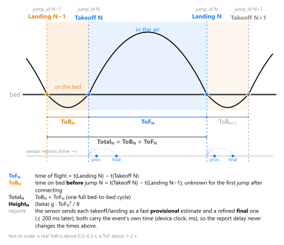

# OpenToF

**Open-source time-of-flight measurement for trampolining.** A small sensor clipped to the trampoline bed detects
every takeoff and landing, and a phone app shows how long each jump was in the air, runs timed routines and exports
the results.

OpenToF is a training aid and is meant for informal competitions. It is not certified for official (FIG) competition
scoring.

## How it works

The sensor (a Seeed XIAO MG24 Sense with its built-in accelerometer and gyroscope) sits on the bed and feels each
bed contact: the sharp impact of a landing, the push-off and the free ringing after the takeoff. Its detection
algorithm reports every **takeoff** and **landing** over Bluetooth Low Energy with a timestamp. The app turns these
into the numbers athletes and coaches care about:

- **Time of flight (ToF)** = landing − takeoff of the same jump.
- **Time on bed (ToB)** = takeoff − the previous landing.
- **Total jump time** = ToB + ToF; **height** (beta) = g · ToF² / 8.

Each event can be sent twice: first a fast *provisional* estimate, so the app can beep and show the jump right away,
then a refined *final* one shortly after, which replaces it. Both carry the time of the event itself, so Bluetooth
delays never change the measured times. The details are in [`docs/PROTOCOL.md`](docs/PROTOCOL.md).

## Features

- Live flight time of the last jump, a chart of recent jumps, optional time on bed and total jump time.
- Routines with a configurable number of jumps: press Start while jumping and the jump in progress counts as #1,
  a beep per jump and a final sound, automatic stop after inactivity.
- CSV export of a routine or of the last 30 s / 1 min / 5 min of jumps.
- Missed and uncertain jumps are flagged; optional extra per-jump values from the detection algorithm
  (confidence, landing and push-off intensity, …).
- The sensor sleeps when nobody uses it and wakes up when it is shaken; the app can also send it to sleep.
  Its LED signals are explained in the app (*Settings → LED signals*).
- In-app changelog, English and German, light and dark theme, Android 10+ and iOS 15+.
- Pluggable detection algorithms in the firmware; a demo mode sends simulated jumps for testing without a
  trampoline.

## Getting started

**Hardware:** a [Seeed XIAO MG24 Sense](https://www.seeedstudio.com/Seeed-XIAO-MG24-Sense-p-6248.html), a single-cell
LiPo, and the 3D-printed housing with trampoline clip from [`cad/`](cad/).

**Firmware:** build and flash `firmware/OpenToF_Firmware/` with the Arduino IDE. Setup, configuration and how to
write a detection algorithm are in [`firmware/README.md`](firmware/README.md).

**App:** with the Flutter SDK installed, run `flutter run` from `app/`. In the app, open *Settings → Scan for sensors*
and pick your sensor. Debug builds also include a simulated sensor. See [`app/README.md`](app/README.md).

App and firmware share their MAJOR.MINOR version (e.g. app 0.6.x works with firmware 0.6.x); the app warns if they
don't match.

## Repository layout

| Folder | Contents |
|---|---|
| [`app/`](app/) | Flutter companion app (Android + iOS) |
| [`firmware/`](firmware/) | Arduino sensor firmware (`OpenToF_Firmware/`) and helper/test sketches |
| [`software/`](software/) | Python tools for recording and plotting raw IMU data (`uv run <script>`) |
| [`cad/`](cad/) | Parametric FreeCAD housing with trampoline clip, printable STLs |
| [`img/`](img/) | Logo and wordmark sources (light and dark), `make_wordmark.py` |
| [`docs/`](docs/) | Protocol, decisions, roadmap, figures and hardware datasheets |

## Documentation

| Document | What it answers |
|---|---|
| [`Changelog.md`](Changelog.md) | What changed in each version (also shown in the app) |
| [`docs/PROTOCOL.md`](docs/PROTOCOL.md) | The BLE interface between sensor and app, and the rules for detection algorithms |
| [`docs/DECISIONS.md`](docs/DECISIONS.md) | Product and engineering decisions and why they were made, plus open questions |
| [`docs/ROADMAP.md`](docs/ROADMAP.md) | Architecture overview and what is still open or unverified |
| [`app/README.md`](app/README.md) | Building, testing and running the app |
| [`firmware/README.md`](firmware/README.md) | Building and configuring the firmware, writing an algorithm, LED signals |
| [`cad/README.md`](cad/README.md) | Printing and assembling the housing |
| [`docs/hardware/`](docs/hardware/) | Datasheets: board schematic, IMU, battery, LSM6DS3 application note |

## Releasing

App and firmware are released together. Every commit that changes the app (`app/`) or the main firmware
(`firmware/OpenToF_Firmware/`) bumps a version:

- **App:** `version:` in `app/pubspec.yaml` (`MAJOR.MINOR.PATCH+BUILD`; always bump the build number too).
- **Firmware:** `FIRMWARE_VERSION` in `firmware/OpenToF_Firmware/config/FirmwareConfig.h`.
- **Major and minor bumps apply to both** (same MAJOR.MINOR, PATCH reset to 0), even if only one of them changed.
  A patch bump only touches the part that changed.
- Helper sketches, `software/`, `cad/` and docs don't need a version bump.

Every version gets an entry in [`Changelog.md`](Changelog.md), written for users and algorithm authors (what
changed, not why). Its format is read by the app, so keep to it:

- `## <version> — <date>` per release, then `### App` and/or `### Sensor firmware` sections. A section whose heading
  names both (or neither) appears in both tabs of the in-app changelog.
- Only paragraphs, `-` bullets, `**bold**`, `*italic*` and `` `code` `` (no tables, links or nested lists).
- After editing it, run `dart run tool/sync_changelog.dart` in `app/` to update the app's copy
  (`app/assets/changelog/Changelog.md`); `flutter test` fails while the copy is out of date.

## Status

Early development. The firmware runs on real hardware and the app is tested against a simulated sensor; a full
end-to-end check over real Bluetooth is still open. The default detector (`BedCycleJumpDetector`) was developed on
recorded trampoline data and is still being tuned. The BLE UUIDs are placeholders until the protocol is frozen.
What is still open is listed in [`docs/ROADMAP.md`](docs/ROADMAP.md).
